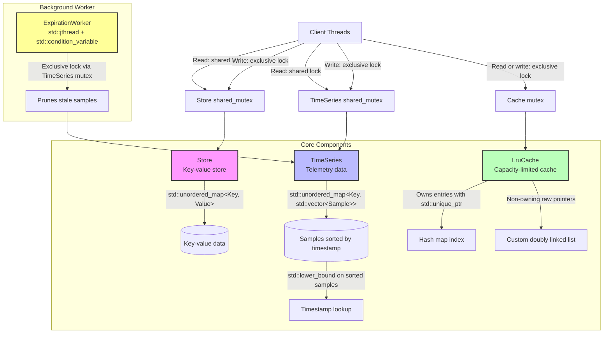

# In-Memory Telemetry Store

[](https://en.cppreference.com/w/cpp/20)
[](https://cmake.org/)
[](LICENSE)

A high performance, concurrent C++20 embedded telemetry database feauturing an in-memory key-value store and
time-series store. It includes a custom pointer-backed LRU cache and an automated background expiration
worker that removes expired time-series samples.

## Features & Architechture



* **`Store`**: A thread-safe string-to-string key-value store protected by a reader-writer mutex (`std::shared_mutex`) enabling concurrent reads with exclusive writes.
* **`TimeSeries`**: Timestamped numeric telemetry samples that remain sorted chronologically via `std::lower_bound` insertions, supporting inclusive time-range queries and bulk pruning.
* **`LruCache`**: A capacity-limited cache combining an unordered map and a custom doubly linked list. The hash map strictly owns nodes using `std::unique_ptr`, while list links use non-owning raw pointers for optimal reordering and safety.
* **`ExpirationWorker`**: A background thread using `std::jthread` and condition variables (`std::condition_variable_any`) to periodically and safely prune stale time-series data with clean cancellation semantics.


## Benchmarks

Measured on WSL Ubuntu 26.04 (Release build, `-O3` optimization):

| Component | Operation | Iterations | Throughput |
| :--- | :--- | :--- | :--- |
| `Store` | Key-Value Insert (`put`) | 100,000 | ~432900 ops/sec |
| `LruCache` | Put / Get Cycle (Capacity 10k) | 200,000 | ~347222 ops/sec |
| `TimeSeries` | Chronological Append (`append`) | 50,000 | ~270k ops/sec |


## Build Instructions

Requires a C++20 compiler (eg. GCC 10+/clang 10+), CMake 3.16+, and a threading library.


```bash 

# clone and configure in Release mode for performance
cmake -S . -B build -DCMAKE_BUILD_TYPE=Release
cmake --build build

```
### Running Tests

The project uses CTest for automated unit testing and concurrent thread safety validation[cite: 1]:

``` bash 

ctest --test-dir build --output-on-failure

```
### Running Sanitizers

Memory, undefined behaviour, and data-race safety have been verified using Clang/GCC

``` bash
cmake -S . -B build-asan \
    -DCMAKE_CXX_FLAGS="-fsanitize=address,undefined -fno-omit-frame-pointer" \
    -DCMAKE_EXE_LINKER_FLAGS="-fsanitize=address,undefined"
cmake --build build-asan
ctest --test-dir build-asan --output-on-failure

```
### Thread Sanitizer (TSan)

```bash
cmake -S . -B build-tsan \
  -DCMAKE_CXX_FLAGS="-fsanitize=thread -fno-omit-frame-pointer" \
  -DCMAKE_EXE_LINKER_FLAGS="-fsanitize=thread"
cmake --build build-tsan
ctest --test-dir build-tsan --output-on-failure

```
### To check the benchmarks

To verify the becnchmarks

``` bash
# Build the benchmark target
cmake --build build-release --target store-benchmark

# Run the benchmark executable directly
./build-release/store-benchmark 

```
## Design Choices & Limitations

-Timestamps: Time-series timestamps are tracked as integer seconds since the Unix epoch[cite: 1].
-Vector Storage: Time-series samples are stored in contiguous std::vector containers. 
While cache-friendly for lookups, inserting out-of-order samples requires shifting elements ($\mathcal{O}(n)$ insertion complexity)[cite: 1].
-Memory Model: This is an in-memory demonstration project and does not implement a persistent disk storage layer[cite: 1].
-Worker Lifecycles: The ExpirationWorker holds a direct reference to its target 
-TimeSeries; the target series instance must outlive the worker thread[cite: 1].

## Project Layout

```Plaintext
├── include/           # Public class headers (Store, TimeSeries, LruCache, ExpirationWorker)
├── src/               # Class implementations
├── tests/             # Unit tests, concurrency tests, and benchmark executables
└── CMakeLists.txt     # Main CMake build configuration
```
## License

This project is licensed under the terms of the MIT License. 
See the LICENSE file for details.
